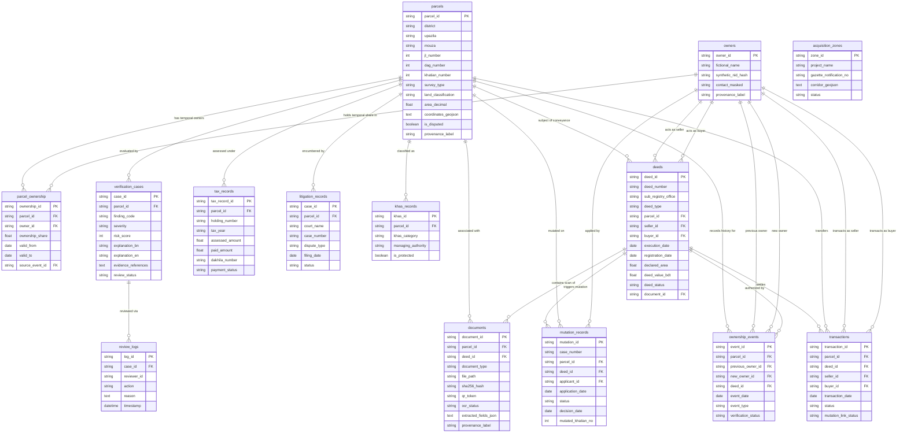

# ENTITY-RELATIONSHIP DESIGN (ERD) & RELATIONAL ARCHITECTURE
## DESHMRITTIKA / BHUMI-SYNC
**Document Version:** 1.0.0 (Phase 1 Baseline)  
**Date:** October 17, 2026  
**Scope:** Unified Relational Architecture Supporting Tracks P1 through P6.

---

## 1. Visual Entity-Relationship Diagram (Mermaid)

---

## 2. Relational Cardinality & Cascade Integrity Rules

| Parent Entity | Child Entity | Cardinality | Foreign Key Constraint | Delete / Cascade Behavior | Business & Integrity Rule |
|---|---|---|---|---|---|
| `parcels` | `parcel_ownership` | 1 to Many (1:N) | `parcel_ownership.parcel_id` | `RESTRICT` | A parcel cannot be deleted if historical ownership records exist. |
| `owners` | `parcel_ownership` | 1 to Many (1:N) | `parcel_ownership.owner_id` | `RESTRICT` | An owner profile cannot be purged while holding active or historical shares. |
| `parcels` | `deeds` | 1 to Many (1:N) | `deeds.parcel_id` | `RESTRICT` | Preserves all registered deeds associated with the parcel across history. |
| `parcels` | `transactions` | 1 to Many (1:N) | `transactions.parcel_id` | `RESTRICT` | Financial audit ledger cannot have orphan transactions. |
| `deeds` | `transactions` | 1 to 1 (1:1) | `transactions.deed_id` | `RESTRICT` | Every registered deed maps to exactly one registry transaction settlement. |
| `deeds` | `mutation_records` | 1 to Many (1:N) | `mutation_records.deed_id` | `RESTRICT` | Links deed to its subsequent e-mutation application(s). |
| `parcels` | `documents` | 1 to Many (1:N) | `documents.parcel_id` | `CASCADE` | Scanned legacy khatians, deeds, and receipts belong to the parcel dossier. |
| `deeds` | `documents` | 1 to 1 (1:1) | `deeds.document_id` | `SET NULL` | A deed references its scanned digital facsimile. |
| `parcels` | `tax_records` | 1 to Many (1:N) | `tax_records.parcel_id` | `CASCADE` | Annual tax assessment history per plot. |
| `parcels` | `litigation_records`| 1 to Many (1:N) | `litigation_records.parcel_id`| `CASCADE` | Active civil injunctions and title disputes encumbering the parcel. |
| `parcels` | `khas_records` | 1 to 1 (1:1) | `khas_records.parcel_id` | `CASCADE` | Denotes state 1-No Khas land schedule. |
| `parcels` | `verification_cases`| 1 to Many (1:N) | `verification_cases.parcel_id`| `CASCADE` | Automated double-selling and anomaly audit findings. |
| `verification_cases`| `review_logs`| 1 to Many (1:N) | `review_logs.case_id` | `RESTRICT` | Tamper-evident reviewer audit trail; logs cannot be purged. |

---

## 3. Database Indexes for High-Performance Queries

To ensure rapid sub-second query performance at scale (100,000 parcels and ~500,000 relational links):

1. **Spatial & Search Indexes:**
   - `idx_parcels_mouza_dag_khatian`: `parcels(mouza, dag_number, khatian_number)` — primary search composite index.
   - `idx_parcels_upazila`: `parcels(upazila, district)` — administrative filtering.
2. **Double-Selling Detection Indexes:**
   - `idx_deeds_parcel_seller`: `deeds(parcel_id, seller_id, execution_date)` — detects concurrent transfers by the same seller.
   - `idx_deeds_deed_number`: `deeds(deed_number)` — unique deed registration index.
   - `idx_mutation_deed`: `mutation_records(deed_id, status)` — detects unmutated deed transfers.
3. **Citizen Due Diligence Indexes:**
   - `idx_tax_parcel_status`: `tax_records(parcel_id, payment_status)` — instantaneous tax arrears check.
   - `idx_litigation_parcel`: `litigation_records(parcel_id, status)` — instantaneous active court injunction check.
   - `idx_khas_parcel`: `khas_records(parcel_id, is_protected)` — instantaneous public land protection flag.
4. **Cryptographic Integrity Indexes:**
   - `idx_documents_sha256`: `documents(sha256_hash)` — hash lookup to prevent duplicate file re-uploads or identify file tampering.
