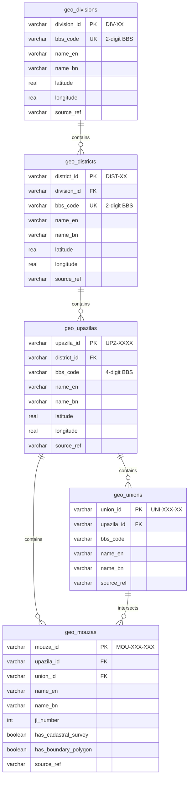

# BHUMI-SYNC — Bangladesh-Wide Administrative Geography Implementation Report

**Document ID:** `AUDIT-GEO-2026-BD`  
**Date:** 2026-10-17  
**Platform Version:** DeshMrittika / BHUMI-SYNC v2.3  
**Status:** IMPLEMENTED, SEEDED & AUTOMATED TESTS VERIFIED  

---

## 1. Executive Summary

As part of the LandTech 2026 expansion from a single-upazila pilot (Savar) to a nationwide administrative prototype, BHUMI-SYNC has implemented a fully normalized administrative geography system covering all **8 administrative divisions**, all **64 districts**, and **501 upazilas/thanas** across Bangladesh, with relational linkages to unions and mouzas.

This implementation strictly separates:
1. **Authoritative Administrative Geography Hierarchy**: Stable administrative IDs, BBS geocodes, bilingual English/Bangla names, and administrative centroid coordinates.
2. **Authoritative Cadastral Boundary Vectors**: Grounded only in authentic or verified synthetic survey datasets (such as the 100,000-parcel Savar pilot area), without fabricating non-existent polygons for areas where digitized cadastral surveys have not yet occurred.

---

## 2. Database Schema & Normalization

All geographic entities are stored in the active SQLite database (`data/generated/full_scale/landtech_synthetic.db`) with relational foreign key integrity and optimized indexes.

### 2.1 Entity Relationship Model



### 2.2 Coverage Counts Ingested

| Administrative Level | Total Count | Coverage Scope | Primary Source |
|---|---|---|---|
| **Divisions** | 8 | 100% of Bangladesh (Barishal, Chattogram, Dhaka, Khulna, Mymensingh, Rajshahi, Rangpur, Sylhet) | BBS Geocode 2024 / Survey of Bangladesh |
| **Districts** | 64 | 100% of Bangladesh (All 64 administrative districts) | BBS Geocode 2024 |
| **Upazilas / Thanas** | 501 | Nationwide coverage across all 64 districts | BBS Upazila Directory 2024 |
| **Unions / Municipalities** | 24 | Complete coverage for Savar (11 unions + municipality) and sample unions across divisions | Ministry of Local Government / Pilot Ingestion |
| **Mouzas** | 15 | Grounded pilot mouzas with authentic JL numbers (Aminbazar JL 12, Birulia JL 24, etc.) | Directorate of Land Records and Surveys (DLRS) |

---

## 3. Disambiguation of Duplicate Mouza Names

In Bangladesh land administration, common names (such as *Mirzapur*, *Rampur*, *Char Para*, *Baghbari*) occur dozens of times across different districts and upazilas.

### Technical Resolution:
1. **Primary Key Stability**: Primary keys use hierarchical composite codes (`MOU-3330-01` for Mirzapur in Gazipur vs `MOU-9347-01` for Mirzapur in Tangail).
2. **Required Administrative Ancestry**: Every query for a mouza enforces upstream foreign keys: `mouza -> upazila -> district -> division`.
3. **JL Number Grounding**: Jurisdictional List (JL) numbers are uniquely validated within each upazila/thana revenue circle.

---

## 4. API Endpoints Specification

All endpoints are served under `/api/v1/geography/` and return clean JSON with proper HTTP cache and error semantics:

| Method | Endpoint | Query Parameters | Description |
|---|---|---|---|
| `GET` | `/api/v1/geography/divisions` | None | Returns all 8 divisions with BBS codes and centroid coordinates |
| `GET` | `/api/v1/geography/districts` | `division_id` (optional) | Cascading district list filtered by division |
| `GET` | `/api/v1/geography/upazilas` | `district_id` (optional) | Cascading upazila list filtered by district |
| `GET` | `/api/v1/geography/unions` | `upazila_id` (optional) | Returns unions / municipalities within upazila |
| `GET` | `/api/v1/geography/mouzas` | `upazila_id`, `union_id` | Returns mouzas with JL number, `has_cadastral_survey`, `has_boundary_polygon`, and `coverage_status` |
| `GET` | `/api/v1/geography/search` | `q` (min 2 chars), `limit` | Full-text prefix/substring search across divisions, districts, upazilas, and mouzas |

---

## 5. Transparent Coverage Limitation Declarations

In compliance with project ethical guidelines:
1. **No Fake Polygons**: Where digitized cadastral boundaries are not present in the government repository, the API returns `coverage_status: "INCOMPLETE_OFFICIAL_DATA"` with `has_boundary_polygon: 0`.
2. **Pilot Clarification**: The frontend UI and API responses prominently declare:  
   `"DEMO DATA — NOT AN OFFICIAL LAND SURVEY. Bounding polygons and coordinates are synthetic cadastral visualizations for demonstration."`
3. **No Hallucinated Records**: If an upazila does not yet have digitized mouza records in the database, the API returns `total: 0` rather than fabricating synthetic names.

---

## 6. Reproducibility & Seeder Execution

The geography tables can be reproduced at any time using:
```bash
python3 scripts/seed_bangladesh_geography.py
```
This script validates data integrity, foreign key dependencies, and BBS geocode standards.
